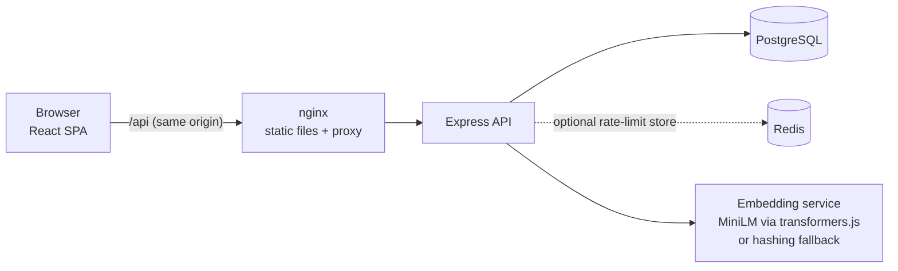

# CredX

A full-stack credit card management app: cards, card transactions, a wallet with
transfers and payments, loans with EMIs, spending analytics, and a virtual
assistant that answers natural-language questions about your own account data
using hybrid (keyword + embedding) search.

**Stack:** React 19 + Vite + Tailwind · Node.js (Express 5) · PostgreSQL (Sequelize) ·
JWT · Docker · Jest

---

## Features

- **Accounts and auth**: registration and login with bcrypt-hashed passwords
  (configurable cost, transparent re-hash), short-lived JWT access tokens and
  single-use, rotating refresh tokens with reuse detection, logout and
  logout-everywhere, password change, token-based password reset.
- **Cards**: add debit and credit cards (Luhn and expiry validation), freeze or
  unfreeze, delete, per-card transaction history. Credit limits depend on the
  credit score.
- **Card spending** with a rule-based fraud check that runs *before* money
  moves: a flagged purchase is declined and the card is frozen.
- **Payments**: pay a credit card bill from the wallet, top up the wallet
  (simulated bank transfer or a credit card), wallet-to-wallet transfers with
  daily limits, loan disbursement and EMI payments. Every money movement runs
  in one database transaction with row locks and writes a ledger entry.
- **Analytics**: monthly spending, per-merchant and per-category totals,
  computed in SQL.
- **Virtual assistant**: "How much did I spend on food last month?", "Show my
  recent card transactions", "What's my loan EMI?", "What's my credit
  limit?"... Answers cite the records they are based on.
- **Admin API**: list users, fraud-flagged transactions, freeze a card.

### Security practices

These are implemented practices, not a compliance certification. The app has
not been assessed against PCI DSS, and simulated payments are not real ones.

- Full card numbers and CVVs are **never stored or returned**. The API validates
  them in memory and keeps only the brand, the last four digits, a masked number
  and a keyed HMAC fingerprint (for duplicate detection). Older databases are
  scrubbed on startup (see [Database](#database-and-schema-upgrades)).
- Every card, transaction, loan and assistant query is scoped to the
  authenticated user. Ownership is checked on every card route.
- CORS allowlist from `CORS_ORIGINS`; global, auth and assistant rate limits
  (in-memory, or Redis when `REDIS_URL` is set); helmet security headers;
  request ids; input validation with zod on every write endpoint.
- Consistent JSON errors that never leak SQL or stack traces. The logger never
  logs request bodies and redacts credential and card fields.
- No secrets in the repository, and the server refuses weak or missing secrets
  (see [Configuration and secrets](#configuration-and-secrets)).

---

## Architecture



In development the Vite dev server serves the SPA and proxies `/api` to the API
instead of nginx.

```
CredX-Fintech/
  backend/
    src/
      app.js, server.js         Express app factory, process entry point
      config/                   env config + validation, DB, Redis, associations
      db/migrations.js          boot-time schema upgrades + sync
      middlewares/              auth, roles, validation, rate limits, errors, request ids
      modules/
        auth/                   register/login/refresh/reset, token service, refresh-token sessions
        cards/                  cards, spending, fraud check, analytics
        wallet/                 wallet routes + the ledger service (all money movement)
        transactions/           transfers, ledger history
        loans/                  quotes, applications, EMI payments
        admin/                  admin-only routes
        assistant/              query parsing, documents, retrieval, embeddings, answers
      utils/                    money, card utilities, EMI, credit score, fraud rules, logger
    scripts/                    setup-env.js, seed.js
    tests/                      Jest unit + API tests (in-memory SQLite)
  frontend/                     React app (pages, API client, nginx config, Dockerfile)
  docker-compose.yml
```

---

## Getting started (local development)

Requirements: Node.js 20+ and PostgreSQL 14+ (Docker users can skip PostgreSQL,
see below).

```bash
# Backend
cd CredX-Fintech/backend
npm install
npm run setup:env        # creates backend/.env with random JWT secrets (never overwrites)
# edit backend/.env: set DB_USER / DB_PASSWORD (and DB_NAME / DB_HOST if needed)
npm run dev              # http://localhost:5000 (creates/updates tables on boot)
npm run seed             # optional: demo user with sample data (see below)

# Frontend (second terminal)
cd CredX-Fintech/frontend
npm install
npm run dev              # http://localhost:5173, /api is proxied to the backend
```

`npm run seed` creates the demo user from `SEED_DEMO_EMAIL`. If
`SEED_DEMO_PASSWORD` is empty it generates a random password and prints it once.
Set `SEED_ADMIN_EMAIL` to also create (or promote) an admin. The seed script
refuses to run with `NODE_ENV=production`.

The root `CredX-Fintech/package.json` is a small dev runner with no dependencies
of its own (`npm run install:all`, `npm run dev:backend`, `npm run dev:frontend`,
`npm test`, `npm run lint`, `npm run build`).

## Running with Docker

```bash
cd CredX-Fintech/backend && npm run setup:env -- --docker   # creates CredX-Fintech/.env with random secrets
cd .. && docker compose up --build                          # http://localhost:8080
```

- Services: `postgres` (data in the `postgres-data` volume), `backend` (waits for a
  healthy database), `frontend` (nginx on `127.0.0.1:8080`, proxies `/api` to the
  backend). Only nginx publishes a port.
- The embedding model downloads on first use into the `model-cache` volume.
  Build with `WITH_EMBEDDINGS=false` for a smaller image that uses the hashing
  embedder only.
- Optional Redis rate-limit store: set `REDIS_URL=redis://redis:6379` in `.env`
  and run `docker compose --profile redis up --build`.
- Demo data inside Docker:
  `docker compose exec -e NODE_ENV=development -e SEED_DEMO_EMAIL=you@example.com backend node scripts/seed.js`

`docker compose` refuses to start while `POSTGRES_PASSWORD`, `JWT_SECRET` or
`JWT_REFRESH_SECRET` is missing.

---

## Configuration and secrets

All configuration comes from environment variables, read in one place
(`backend/src/config/config.js`) and documented in `backend/.env.example`,
`CredX-Fintech/.env.example` (Docker) and `frontend/.env.example`.

**Rules**

- Secrets have no defaults anywhere: not in code, config, seeds, Dockerfiles,
  compose or CI. Only non-secret settings (localhost, ports, limits, model name)
  have defaults.
- On startup the server validates its configuration and refuses to start, with
  a list of problems, if `JWT_SECRET` or `JWT_REFRESH_SECRET` is missing,
  shorter than 32 characters, or equal; if database credentials are missing;
  or if a secret still holds a placeholder from `.env.example`. Error messages
  name the variable, never the value.
- `.env` files are gitignored; only the `.env.example` templates are tracked.
- The test suite never reads `.env`: its setup generates throwaway secrets with
  `crypto.randomBytes`. CI needs no repository secrets.

**`npm run setup:env`** (in `backend/`) copies `backend/.env.example` to
`backend/.env`, filling each `<generated-by-setup-env>` placeholder with
`crypto.randomBytes(48).toString('hex')`. `-- --docker` does the same for the
compose file `CredX-Fintech/.env` (including `POSTGRES_PASSWORD`), `-- --all`
does both. It never reads, overwrites or prints an existing file, and never
prints generated values. To create a single secret by hand:
`node -e "console.log(require('crypto').randomBytes(48).toString('hex'))"`.

**Production**

- Inject secrets as environment variables from your platform's secret store
  (for example Docker/Kubernetes secrets, AWS Secrets Manager or SSM, GCP Secret
  Manager, GitHub Actions `secrets.*` for deploy jobs). Do not bake them into
  images; the Dockerfiles copy no `.env` files (`.dockerignore` excludes them).
- Use distinct random values per environment. Rotating `JWT_SECRET` signs
  everyone out; rotating `JWT_REFRESH_SECRET` forces a new login after the
  access token expires; rotating `CARD_FINGERPRINT_SECRET` only affects
  duplicate-card detection for cards added earlier.
- If a `.env` file was ever committed or shared, rotate every secret in it.
- Keep `AUTH_EXPOSE_RESET_TOKEN` off (it is forced off in production) and wire
  password-reset delivery to an e-mail provider.

### Environment variables

Backend (`backend/.env`; in Docker these are set by `docker-compose.yml` from `CredX-Fintech/.env`):

| Variable | Required | Secret | Default | Purpose |
|---|---|---|---|---|
| `NODE_ENV` | no | no | `development` | `production` enables stricter checks and defaults |
| `PORT` | no | no | `5000` | API port |
| `TRUST_PROXY` | no | no | off | Proxy hops to trust (`1` behind nginx) so rate limits see client IPs |
| `DATABASE_URL` | one of | **yes** | none | Postgres connection URL (alternative to the `DB_*` settings) |
| `DB_HOST` | yes¹ | no | `localhost` outside production | Postgres host |
| `DB_PORT` | no | no | `5432` | Postgres port |
| `DB_NAME` | yes¹ | no | none | Database name |
| `DB_USER` | yes¹ | no | none | Database user |
| `DB_PASSWORD` | yes¹ | **yes** | none | Database password |
| `DB_SSL`, `DB_SSL_REJECT_UNAUTHORIZED` | no | no | `false`, `true` | TLS to Postgres |
| `DB_SYNC` | no | no | `alter` (dev), `safe` (prod) | Schema management on boot: `alter`, `safe` or `none` |
| `DB_LOGGING` | no | no | `false` | Log SQL at debug level |
| `DB_POOL_MAX`, `DB_POOL_MIN`, `DB_POOL_IDLE_MS`, `DB_POOL_ACQUIRE_MS` | no | no | `10`, `0`, `10000`, `30000` | Connection pool |
| `DB_CONNECT_RETRIES`, `DB_CONNECT_RETRY_DELAY_MS` | no | no | `10`, `3000` | Wait for the database on boot |
| `JWT_SECRET` | **yes** | **yes** | none | Access-token signing key (32+ chars) |
| `JWT_REFRESH_SECRET` | **yes** | **yes** | none | Refresh-token signing key (32+ chars, different) |
| `CARD_FINGERPRINT_SECRET` | no | **yes** | derived from `JWT_SECRET` | HMAC key for card fingerprints (32+ chars) |
| `JWT_ACCESS_TTL`, `JWT_REFRESH_TTL` | no | no | `15m`, `7d` | Token lifetimes |
| `JWT_ISSUER`, `JWT_AUDIENCE` | no | no | `credx-api`, `credx-app` | Pinned token claims |
| `BCRYPT_ROUNDS` | no | no | `12` | bcrypt cost (10-15 in production) |
| `AUTH_EXPOSE_RESET_TOKEN` | no | no | `false` | Return the reset token in the API response (local demos only, forced off in production) |
| `AUTH_RESET_TOKEN_TTL_MINUTES` | no | no | `15` | Reset token lifetime |
| `CORS_ORIGINS` | no | no | `http://localhost:5173,http://127.0.0.1:5173` (dev), none (prod) | Comma-separated allowed browser origins |
| `RATE_LIMIT_WINDOW_MS`, `RATE_LIMIT_MAX` | no | no | `900000`, `300` | Global limit per IP on `/api` |
| `AUTH_RATE_LIMIT_WINDOW_MS`, `AUTH_RATE_LIMIT_MAX` | no | no | `900000`, `20` | Stricter limit on auth endpoints |
| `ASSISTANT_RATE_LIMIT_WINDOW_MS`, `ASSISTANT_RATE_LIMIT_MAX` | no | no | `60000`, `30` | Per-user assistant limit |
| `REDIS_URL` | no | yes, if it contains a password | none (in-memory) | Shared rate-limit store |
| `TRANSFER_DAILY_LIMIT`, `TRANSFER_DAILY_COUNT` | no | no | `5000`, `5` | Wallet transfer limits |
| `LOAN_MAX_ACTIVE` | no | no | `3` | Maximum active loans per user |
| `EMBEDDINGS_PROVIDER` | no | no | `transformers` (`hashing` in tests) | Embedding provider |
| `EMBEDDINGS_MODEL`, `EMBEDDINGS_DTYPE` | no | no | `Xenova/all-MiniLM-L6-v2`, `q8` | Local sentence-embedding model |
| `EMBEDDINGS_CACHE_DIR` | no | no | library default | Model download cache |
| `EMBEDDINGS_WARMUP` | no | no | `true` (`false` in tests) | Load the model in the background at startup |
| `EMBEDDINGS_WAIT_MS`, `EMBEDDINGS_RETRY_MS`, `EMBEDDINGS_CACHE_SIZE` | no | no | `2000`, `300000`, `5000` | Wait for a loading model, retry a failed load, LRU vector cache size |
| `ASSISTANT_FUSION` | no | no | `weighted` | `weighted` or `rrf` score fusion |
| `ASSISTANT_KEYWORD_WEIGHT` | no | no | `0.4` | BM25 weight; embeddings get `1 - weight` |
| `ASSISTANT_RRF_K` | no | no | `60` | RRF damping constant |
| `ASSISTANT_MIN_SIMILARITY_MODEL`, `ASSISTANT_MIN_SIMILARITY_HASHING` | no | no | `0.3`, `0.2` | Minimum cosine similarity for a semantic match |
| `ASSISTANT_RELATIVE_CUTOFF` | no | no | `0.85` | A semantic match must also reach this fraction of the best match |
| `ASSISTANT_TOP_K`, `ASSISTANT_MAX_RECORDS` | no | no | `5`, `500` | Citations returned; records loaded per type |
| `CURRENCY`, `LOCALE` | no | no | `INR`, `en-IN` | Answer formatting |
| `LOG_LEVEL`, `HTTP_LOG_FORMAT` | no | no | `info`, `dev` (`short` in prod) | Logging |
| `DB_DIALECT`, `DB_STORAGE` | tests only | no | `postgres`, `:memory:` | The test suite uses in-memory SQLite |
| `SEED_DEMO_EMAIL` | for `npm run seed` | no | none | Demo user e-mail |
| `SEED_DEMO_PASSWORD`, `SEED_ADMIN_PASSWORD` | no | **yes** | generated and printed once | Seed passwords |
| `SEED_ADMIN_EMAIL` | no | no | none | Create or promote an admin when seeding |

¹ Unless `DATABASE_URL` is set.

Docker Compose (`CredX-Fintech/.env`):

| Variable | Required | Secret | Default | Purpose |
|---|---|---|---|---|
| `POSTGRES_PASSWORD` | **yes** | **yes** | none | Database password (postgres container and API) |
| `JWT_SECRET`, `JWT_REFRESH_SECRET` | **yes** | **yes** | none | Passed to the API |
| `CARD_FINGERPRINT_SECRET` | no | **yes** | derived | Passed to the API |
| `POSTGRES_DB`, `POSTGRES_USER` | no | no | `credx`, `credx` | Database name and user |
| `FRONTEND_PORT` | no | no | `8080` | Host port for nginx (bound to 127.0.0.1) |
| `CORS_ORIGINS` | no | no | `http://localhost:8080` | Origins allowed to call the API directly |
| `REDIS_URL` | no | maybe | none | Set to `redis://redis:6379` with the `redis` profile |
| `EMBEDDINGS_PROVIDER` | no | no | `transformers` | `hashing` skips the model download |
| `WITH_EMBEDDINGS` | no | no | `true` | Build the API image with the local embedding runtime |

Frontend (`frontend/.env.local`, optional):

| Variable | Required | Secret | Default | Purpose |
|---|---|---|---|---|
| `VITE_API_URL` | no | no (public, bundled) | `/api` | API base URL used by the browser |
| `DEV_API_PROXY_TARGET` | no | no (dev server only) | `http://localhost:5000` | Where `npm run dev` proxies `/api` |

Only `VITE_*` variables reach the browser bundle; never put secrets in them.

---

## REST API

37 endpoints, all under `/api`. JSON in and out; errors look like
`{ "message", "code", "details"? }`. "User" means an
`Authorization: Bearer <accessToken>` header is required.

| Method | Path | Auth | Description |
|---|---|---|---|
| GET | `/api/health` | none | Liveness/readiness (database and embedder status) |
| POST | `/api/auth/register` | none | Create an account and its wallet |
| POST | `/api/auth/login` | none | Get an access + refresh token pair |
| POST | `/api/auth/refresh` | none (refresh token) | Rotate the refresh token and get a new pair |
| POST | `/api/auth/logout` | none (refresh token) | Revoke this session |
| POST | `/api/auth/logout-all` | user | Revoke every session |
| GET | `/api/auth/profile` | user | Profile with wallet balance |
| POST | `/api/auth/change-password` | user | Change the password (signs out other sessions) |
| POST | `/api/auth/forgot-password` | none | Issue a single-use reset token |
| POST | `/api/auth/reset-password` | none (reset token) | Set a new password |
| GET | `/api/wallet` | user | Wallet balance |
| POST | `/api/wallet/add-money` | user | Top up from a simulated bank transfer or a credit card |
| POST | `/api/wallet/transfer` | user | Transfer to another user (`email` field, kept for older clients) |
| POST | `/api/transactions/transfer` | user | Transfer to another user by `receiverEmail` |
| GET | `/api/transactions/history` | user | Wallet ledger (`?type=&limit=&offset=`) |
| POST | `/api/cards/create` | user | Add a card (number and CVV validated, never stored) |
| GET | `/api/cards` | user | Your cards (masked) |
| GET | `/api/cards/:id` | user | One card |
| DELETE | `/api/cards/:cardId` | user | Remove a card (credit cards must be paid off) |
| POST | `/api/cards/spend` | user | Card purchase with fraud check |
| POST | `/api/cards/pay-bill` | user | Pay a credit card bill from the wallet |
| POST | `/api/cards/toggle-freeze` | user | Freeze or unfreeze a card |
| POST | `/api/cards/simulate` | user | Generate sample purchase history (no balance changes) |
| GET | `/api/cards/:cardId/transactions` | user | Transactions of one card |
| GET | `/api/cards/spendings` | user | All card transactions and total spent |
| GET | `/api/cards/analytics` | user | Monthly spending summary |
| GET | `/api/cards/analytics/categories` | user | Totals by merchant or category (`?groupBy=`) |
| GET | `/api/loans/quote` | user | EMI quote for `?amount=&tenureMonths=` |
| POST | `/api/loans/apply` | user | Apply (credit-score based) and receive the money in the wallet |
| GET | `/api/loans` | user | Your loans |
| POST | `/api/loans/pay` | user | Pay one EMI from the wallet |
| POST | `/api/assistant/query` | user | Ask the virtual assistant |
| GET | `/api/assistant/suggestions` | user | Example questions |
| GET | `/api/assistant/status` | user | Active embedding provider |
| GET | `/api/admin/users` | admin | Users (paginated, no password data) |
| GET | `/api/admin/frauds` | admin | Fraud-flagged card transactions |
| POST | `/api/admin/freeze-card` | admin | Freeze any card |

---

## Virtual assistant design

`POST /api/assistant/query` with `{ "query": "...", "utcOffsetMinutes": 330, "topK": 5 }`
returns `{ answer, intent, filters, facts, citations[], retrieval }`.

1. **Query understanding** (`assistant/query/`): a weighted keyword/regex vote picks
   an intent (spending summary, card transactions, wallet activity or balance,
   cards and credit, loans, fraud alerts, credit score, help, general search).
   It also extracts time ranges in the user's own time zone ("last month",
   "past 7 days", "in October"), categories through synonyms ("restaurants" means
   food), merchants that appear in the user's own history, card filters (type,
   brand, last four), amount bounds and result limits. Remaining content words
   ("coffee", "yoga") become topic terms.
2. **Documents** (`assistant/documents.js`): the user's account, wallet, cards,
   loans, card transactions and ledger rows become documents. Each has a
   descriptive `text` for keyword search (with category synonyms), a short
   `embedText` for the embedding model (for example "Starbucks (food & dining)"),
   a display snippet and structured metadata. Only masked card data is used.
3. **Candidates**: the document types the intent needs, narrowed by the
   structured filters.
4. **Hybrid retrieval** (`assistant/retrieval/`):
   - BM25 (k1 = 1.2, b = 0.75) over the query plus expansion terms;
   - cosine similarity between the query embedding and document embeddings;
   - fusion, `weighted` by default:
     `score = w * minmax(bm25) + (1 - w) * minmax(cosine)` with
     `w = ASSISTANT_KEYWORD_WEIGHT` (0.4), or weighted reciprocal-rank fusion
     (`ASSISTANT_FUSION=rrf`);
   - for free-text topics a record matches if it shares a keyword or its
     similarity reaches both the embedder's threshold and 85% of the best
     similarity, so "coffee" finds Starbucks purchases without also matching
     every other food record.
5. **Answer**: a template per intent, filled with exact SQL aggregates (for
   example the food total for last month) or values from the retrieved records.
   No language model generates text, so answers cannot invent numbers. The top
   records are returned as citations with their keyword, semantic and fused
   scores.

**Embeddings** (`assistant/embeddings/`) are pluggable. The default is a local
sentence-embedding model, `Xenova/all-MiniLM-L6-v2` (8-bit quantised, 384
dimensions) via `@huggingface/transformers`, downloaded once and loaded lazily
in the background. No API key or paid service is involved. Until the model is
ready, or if it cannot load (offline, CI, unsupported platform), the service
falls back automatically to a deterministic hashed character n-gram embedder,
which is also what the tests use. A failed load is retried later. All texts in
one request are embedded by the same embedder, and vectors are cached in an
LRU.

**Privacy**: every query loads only the authenticated user's records, the
endpoint is rate limited per user, and logs record only the intent, counts and
timing, never the question or any account data.

**Limitations**: intent detection is rule-based (English only); multi-part
questions get one answer; the hashing fallback captures spelling and word
overlap but not meaning.

---

## Database and schema upgrades

`server.js` runs `db/migrations.js` before listening:

- `DB_SYNC=alter` (development default): Sequelize creates and alters tables to
  match the models. `safe` (production default) only adds missing tables,
  columns and indexes. `none` leaves the schema to you.
- Idempotent upgrades for databases created by earlier versions: stored card
  numbers and CVVs are converted to masked data and the columns are dropped;
  legacy NOT NULL constraints on ledger sender/receiver are relaxed; old card
  transactions get a category from the merchant name.
- Money columns are `DECIMAL(14,2)`. Indexes back the hot queries: card
  transactions by card and date, ledger rows by sender/receiver and date,
  cards, wallets and loans by user, and a named unique index on e-mail.

## Tests and CI

```bash
cd CredX-Fintech/backend && npm test       # 158 tests, in-memory SQLite, no PostgreSQL or network
cd CredX-Fintech/frontend && npm run lint && npm run build
```

Unit tests cover BM25, cosine similarity, score fusion, hybrid search,
tokenisation, intent and time-range parsing, EMI, credit score, fraud rules,
card utilities, config validation, log redaction, the embedding fallback and
`setup:env`. API tests (supertest) cover auth (hashing, token rotation and
reuse detection, logout, password reset, rate limits, CORS), payments
(including rollback on an injected failure), card data protection and
ownership, transfers, loans, the assistant (answers, citations, cross-user
isolation, validation) and schema upgrades of a legacy database.

GitHub Actions (`.github/workflows/ci.yml`) runs the backend tests, the frontend
lint and build, validates `docker-compose.yml` and builds both images. It needs
no repository secrets.
